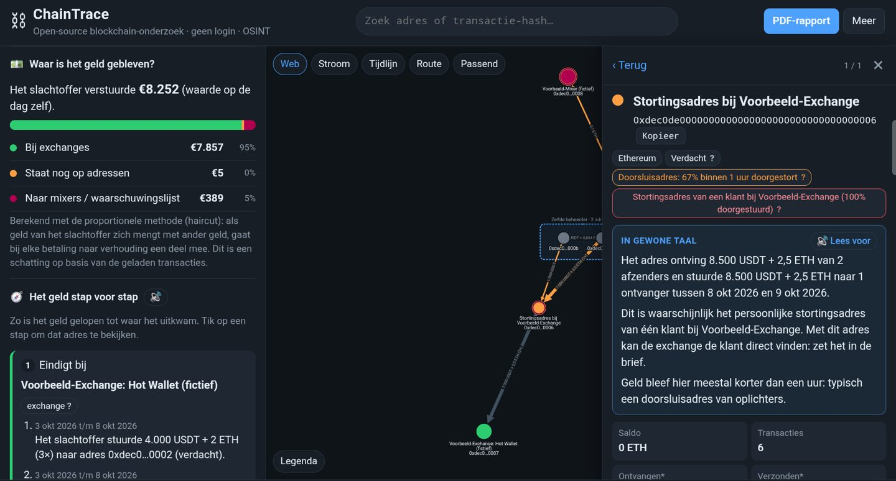
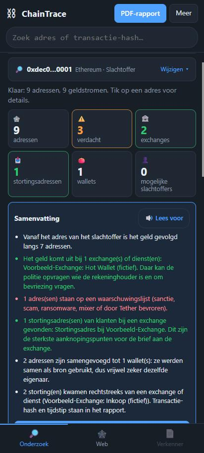
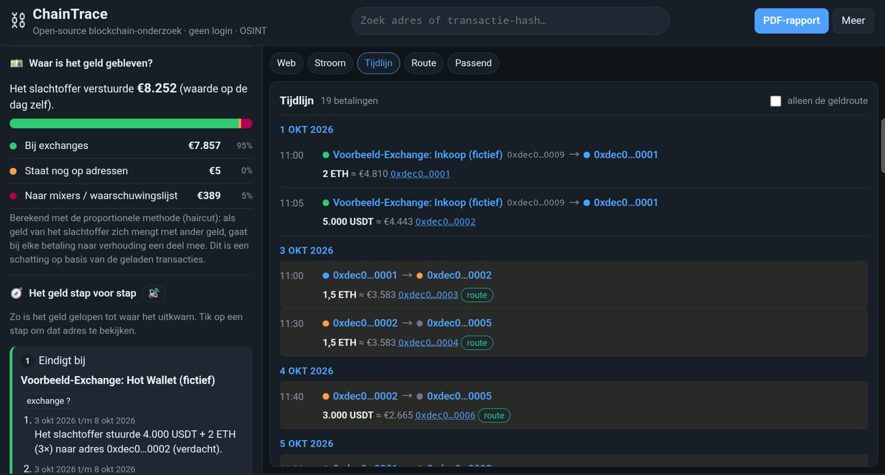
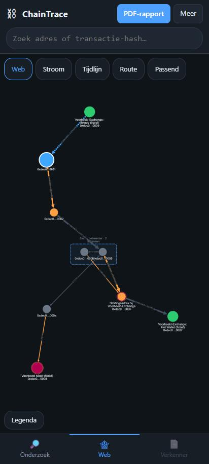

# ChainTrace

**Open-source blockchain-onderzoek voor iedereen: geen account, geen licentie, gegevens blijven op je eigen apparaat.**

Plak een walletadres van een slachtoffer of een dader. ChainTrace volgt het geld, laat in gewone taal zien waar het heen ging, rekent uit hoeveel er bij welke exchange terechtkwam, en maakt een rapport voor de aangifte en een kant-en-klare brief aan de exchange om het geld te laten bevriezen.

ChainTrace is gemaakt als **eerste-hulpgereedschap** voor slachtoffers, fraudehelpdesks, wijkrechercheurs, advocaten en journalisten: iedereen die geen dure analyse-licentie heeft maar wel snel moet weten waar het geld is.

> 🇬🇧 *English summary below.*

| Tablet / computer | Telefoon |
|---|---|
|  |  |
|  |  |

*Schermafdrukken van de ingebouwde voorbeeldzaak (verzonnen gegevens).*

---

## Wat kan het?

**Het geld volgen**
- Volgt geld vanaf een adres over meerdere stappen, **in tijdsvolgorde** (alleen geld dat vertrok nadat het binnenkwam).
- **8 blockchains**: Bitcoin, Ethereum, Optimism, Avalanche, zkSync Era, Tron (TRC-20 én TRX), Solana en Litecoin. Bij een 0x-adres dat op meerdere ketens actief is, vraagt de app welke.
- Volgt geld **door swaps** (omwisselen bij een DEX) en **over bridges** naar een andere blockchain (deBridge, Across, LayerZero/Stargate).
- **Herkomst**: zoekt terug waar het geld vandaan kwam — startwallets (mogelijke andere slachtoffers) en instroom vanaf exchanges.

**Begrijpen wat je ziet**
- **"Waar is het geld gebleven?"** — verdeling van het geld van het slachtoffer in euro (waarde op de dag van betaling): bij exchanges, op stortingsadressen, nog op adressen, naar mixers, via bridges, nog niet gevolgd.
- **"Het geld stap voor stap"** — de route in gewone zinnen, van slachtoffer tot exchange.
- **Stortingsadressen**: herkent het persoonlijke klant-stortingsadres bij een exchange — het adres waarmee de exchange de klant kan vinden.
- **Wallets en beheerders**: voegt adressen van dezelfde eigenaar samen met eigen regels (zie [methodes](docs/METHODS.md)).
- Uitleg in gewone taal bij elk adres, een woordenlijst, voorlezen, grote letters, en een ingebouwde rondleiding met een voorbeeldzaak.

**Actie ondernemen**
- **Brief aan de exchange** (Engels of Nederlands) om tegoeden te bevriezen en gegevens te bewaren, al ingevuld met adressen, transacties, het geschatte bedrag en het **officiële politie-meldpunt** van de exchange (Binance, Coinbase, OKX, KuCoin, Kraken, Bybit, Bitvavo, Tether).
- **PDF-rapport** met samenvatting, web, routes, tijdlijn, verdachte adressen en transacties met volledige hash, plus een **controleerbaar dossierbestand** met SHA-256-vingerafdruk en de bron en ophaaltijd van elk gegeven. Op de telefoon direct te delen via mail of WhatsApp.
- **Volgen**: een adres of hele wallet volgen en een melding krijgen zodra er weer geld beweegt (op Android ook als de app dicht is).
- **Mijn zaken**: onderzoeken worden automatisch per zaak bewaard, kunnen samen in één web, en als back-upbestand worden bewaard.

**Samenwerken (optioneel)**
- **Teamserver** in een Docker-container: zaken delen met collega's, samen aan één zaak werken (gelijktijdige wijzigingen worden samengevoegd), opmerkingen, activiteitenlog en teamlabels.
- **Deellink**: een zaak laten bekijken zonder account, of een collega laten meewerken. Zie [server/README.md](server/README.md).

**Werkt overal**
- Webversie (elke browser) en Android-app uit dezelfde code; geschikt voor telefoon (vanaf 6 inch), tablet en computer.
- Zonder server volledig zelfstandig; mét teamserver gedeeld.
- Nederlands en Engels.

---

## Installeren en draaien

**Android**: download de APK bij [Releases](../../releases) en installeer hem (Android vraagt om toestemming voor installatie buiten de Play Store).

**Web, lokaal**
```bash
python -m http.server 8765 --directory web
```
Open http://localhost:8765. De map `web/` is een statische site en kan op elke statische host (bijv. GitHub Pages).

**Teamserver (samenwerken)**
```bash
docker compose up -d --build        # http://<server>:8080 — setup-code: docker compose logs chaintrace
```
Daarna in de app: *Meer → ☁ Team*. HTTPS, back-up en instellingen: [server/README.md](server/README.md).

**Android zelf bouwen**
```bash
./gradlew assembleDebug
adb install -r app/build/outputs/apk/debug/app-debug.apk
```

**Optioneel**: onder *Meer → Instellingen* kun je een eigen (gratis) Solana-server en TronGrid-sleutel invullen voor meer en snellere resultaten. Sleutels blijven op het apparaat.

---

## Databronnen (gratis, zonder sleutel)

| Wat | Bron |
|---|---|
| Bitcoin / Litecoin | mempool.space, litecoinspace.org |
| Ethereum, Optimism | Blockscout (incl. publieke labels zoals "Binance: Hot Wallet") |
| Avalanche | Routescan |
| zkSync Era | zkSync block explorer API |
| Tron | TronGrid |
| Solana | PublicNode RPC (of eigen server) |
| Bridges | deBridge, Across, LayerZero scan |
| Koersen in euro | Binance (dagkoersen) |

### Lokale OSINT-database (Android)

De Android-app houdt een eigen database bij (ca. 200 MB) die dagelijks wordt bijgewerkt. Daarin staat ook de eigen geschiedenis: komt een adres later in een andere zaak terug, dan meldt de app "eerder gezien".

| Bron | Inhoud |
|---|---|
| [OFAC (0xB10C)](https://github.com/0xB10C/ofac-sanctioned-digital-currency-addresses) | sanctieadressen |
| [ScamSniffer](https://github.com/scamsniffer/scam-database) | drainers / scams (EVM) |
| [MyEtherWallet darklist](https://github.com/MyEtherWallet/ethereum-lists) | phishing / scam (EVM) |
| [Forta labelled datasets](https://github.com/forta-network/labelled-datasets) | phishing, kwaadaardige contracten |
| [Etherscan-labels](https://github.com/brianleect/etherscan-labels) | exchanges, protocollen, hacks |
| [Ransomwhere](https://ransomwhe.re) | ransomware-betaaladressen |
| [GraphSense tagpacks](https://github.com/graphsense/graphsense-tagpacks) | exchanges, mixers, darknet, scams |
| Tether USDT-blacklist (Tron en Ethereum) | door Tether bevroren adressen, inclusief opheffingen |

De webversie heeft geen lokale database en laadt OFAC en ScamSniffer rechtstreeks.

---

## Methodes en betrouwbaarheid

Alle regels die de app gebruikt — tijdsvolgorde, wallet-herkenning, stortingsadressen, de proportionele verdeling (haircut), bridges en swaps — staan beschreven in **[docs/METHODS.md](docs/METHODS.md)**, inclusief hun beperkingen.

> **Belangrijk:** de uitkomsten zijn **aanwijzingen, geen bewijs**. ChainTrace kijkt per adres naar de recentste transacties, kent alleen openbare labels en maakt schattingen. Controleer transacties altijd met de transactie-hash in een block explorer. Voor zware zaken is verdere analyse door de politie of een specialist nodig.

## Privacy

Zonder teamserver is er geen server en geen account: onderzoeken, notities, zaken en sleutels blijven op het apparaat. De app vraagt alleen openbare blockchaingegevens op bij de hierboven genoemde diensten.

Met een teamserver staan de ☁ teamzaken (onderzoeken, opmerkingen, teamlabels) op die server, die jullie zelf beheren. Eigen zaken die je niet deelt blijven op het apparaat. Sleutels (Solana, TronGrid) gaan nooit naar de teamserver.

## Bijdragen

Meldingen en verbeteringen zijn welkom via Issues en Pull requests. Er is een zelftest in [`tests/`](tests/) die de belangrijkste functies controleert met echte blockchaingegevens.

## Licentie

[MIT](LICENSE). Meegeleverde bibliotheken: zie [THIRD_PARTY_NOTICES.md](THIRD_PARTY_NOTICES.md).

---

## English summary

**ChainTrace** is a free, open-source blockchain investigation tool for people without a forensic-analytics licence: victims, fraud help desks, local police, lawyers and journalists. No account, no server needed — data stays on your device unless you choose to use your own team server.

Paste a victim's or perpetrator's address and ChainTrace will:
- follow the money (time-ordered) across Bitcoin, Ethereum, Optimism, Avalanche, zkSync Era, Tron, Solana and Litecoin, including through DEX swaps and bridges (deBridge, Across, LayerZero/Stargate);
- explain each address in plain language, detect customer deposit addresses at exchanges and cluster addresses of the same owner with transparent built-in rules;
- estimate where the victim's money ended up, in euros at the time of payment (proportional/haircut method);
- generate a freeze/preservation request letter to the exchange with its verified law-enforcement channel, and a PDF report with a verifiable evidence file (SHA-256);
- watch addresses or whole wallets and notify you when funds move;
- optionally collaborate through a self-hosted **team server** (Docker): shared cases with roles, automatic merging of simultaneous edits, comments, activity log, team labels and view/join links ([server/README.md](server/README.md)).

Web app (any browser) and Android app from one codebase; Dutch and English UI. Methods and limitations: [docs/METHODS.md](docs/METHODS.md). Results are indications, not proof.
