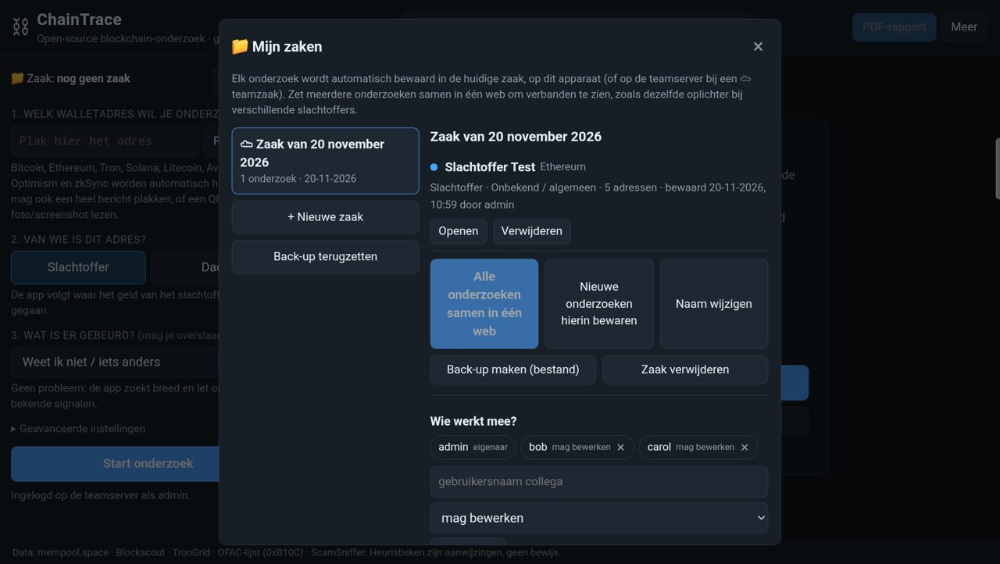

# ChainTrace teamserver

De teamserver is een **optionele** uitbreiding voor teams: een kleine server in een Docker-container die de ChainTrace-webapp levert én zaken deelt tussen collega's. De Android-app en de gewone webversie blijven zonder server werken.



## Wat kun je ermee?

- **Samen aan een zaak werken**: onderzoeken in een ☁ teamzaak worden automatisch op de server bewaard. Teamgenoten zien wijzigingen binnen ongeveer 20 seconden ("bob heeft dit onderzoek bijgewerkt").
- **Gelijktijdig bewerken**: slaan twee mensen tegelijk op, dan voegt de app de versies samen (adressen en geldstromen van beiden blijven bewaard) in plaats van elkaars werk te overschrijven.
- **Rollen per zaak**: eigenaar, mag bewerken, mag alleen kijken.
- **Delen via een link**:
  - *alleen kijken*: iedereen met de link ziet de zaak (alle onderzoeken samen in één web), zonder account;
  - *meewerken*: een collega met een account wordt na inloggen lid van de zaak.
  - Links zijn in te trekken.
- **Opmerkingen** en een **activiteitenlog** per zaak.
- **Teamlabels**: een label dat iemand aan een adres geeft ("Dader A"), ziet het hele team.

## Starten

Vereist: Docker met Docker Compose. Vanuit de hoofdmap van de repository:

```bash
docker compose up -d --build
docker compose logs chaintrace      # hier staat de eenmalige setup-code
```

Open `http://<server>:8080`, kies **Meer → ☁ Team** en maak met de setup-code het eerste beheerdersaccount aan. Daarna maakt de beheerder in hetzelfde scherm accounts aan voor collega's.

In plaats van de setup-code kun je de beheerder ook direct aanmaken met `CT_ADMIN_USER` en `CT_ADMIN_PASSWORD` in `docker-compose.yml`.

### HTTPS (nodig voor de Android-app en aanbevolen voor iedereen)

Met een domeinnaam die naar de server wijst:

```bash
CT_DOMAIN=chaintrace.mijnteam.nl docker compose --profile https up -d --build
```

Caddy haalt dan automatisch een certificaat op. Zet in dat geval `CT_TRUST_PROXY: "1"` en haal de poort `8080` weg uit `docker-compose.yml`, zodat de server alleen via Caddy bereikbaar is.

### Zonder Docker

De server gebruikt alleen de Python-standaardbibliotheek (Python 3.9 of nieuwer):

```bash
python server/chaintrace_server.py           # http://localhost:8080
```

## De Android-app koppelen

In de app: **Meer → ☁ Team**. Vul het adres in (`https://chaintrace.mijnteam.nl`), je gebruikersnaam en wachtwoord. De app moet de server via **https** bereiken; een `http://`-adres wordt door Android geblokkeerd.

Deellinks openen in de browser (de server levert zelf de webapp). Zonder koppeling werkt de app precies zoals voorheen, alles blijft dan op het apparaat.

## Instellingen (omgevingsvariabelen)

| Variabele | Standaard | Betekenis |
|---|---|---|
| `CT_PORT` | `8080` | poort |
| `CT_DATA` | `/data` (container) | map voor de SQLite-database |
| `CT_ADMIN_USER`, `CT_ADMIN_PASSWORD` | – | beheerder bij de eerste start |
| `CT_CORS_ORIGINS` | – | extra websites die de API mogen gebruiken (komma-gescheiden). De Android-app staat er standaard in. |
| `CT_TRUST_PROXY` | `0` | `1` = IP-adres uit `X-Forwarded-For` gebruiken (alleen achter een eigen proxy) |
| `CT_MAX_BODY_MB` | `25` | maximale grootte van een onderzoek |
| `CT_SESSION_DAYS` | `30` | hoe lang je ingelogd blijft |

## Gegevens, back-up en veiligheid

- Alles staat in één SQLite-bestand in het volume `chaintrace-data` (`/data/chaintrace.db`). Back-up maken:
  ```bash
  docker compose exec chaintrace python -c "import sqlite3; sqlite3.connect('/data/chaintrace.db').backup(sqlite3.connect('/data/backup.db'))"
  docker compose cp chaintrace:/data/backup.db ./chaintrace-backup.db
  ```
- Wachtwoorden worden opgeslagen met PBKDF2-SHA256 (310.000 rondes). Sessies en deellinks staan alleen als SHA-256-hash in de database.
- Na 5 mislukte inlogpogingen volgt een oplopende wachttijd.
- De server haalt zelf **geen** blockchaingegevens op: dat doet de app van elke gebruiker rechtstreeks bij de openbare API's, net als zonder server. De server bewaart alleen de onderzoeken, opmerkingen en labels van het team.
- Wie de *alleen kijken*-link heeft, ziet de hele zaak. Deel die link alleen met de bedoelde personen en trek hem in als hij niet meer nodig is.

## API (kort)

Alle routes onder `/api/`, JSON, inloggen met `Authorization: Bearer <token>`.

| Route | Doel |
|---|---|
| `GET info` · `POST setup` · `POST login` · `POST logout` · `GET me` · `POST me/password` | server en account |
| `GET/POST users` · `DELETE users/<naam>` | accounts (beheerder) |
| `GET/POST cases` · `GET/PATCH/DELETE cases/<id>` | zaken |
| `GET/PUT/DELETE cases/<id>/items/<seedKey>` | onderzoeken (dossier-JSON); `PUT` met `base` geeft `409` als iemand anders intussen opsloeg |
| `POST/DELETE cases/<id>/members[/<naam>]` | leden (eigenaar) |
| `GET/POST/DELETE cases/<id>/links[/<id>]` | deellinks (eigenaar) |
| `GET/POST cases/<id>/comments` · `GET cases/<id>/activity` | opmerkingen en log |
| `POST join` · `GET shared/<token>[/items/<seedKey>]` | meedoen via link / alleen kijken |
| `GET/PUT labels` · `GET changes?since=<ms>` | teamlabels en wijzigingen |

## Tests

```bash
python server/test_server.py
```
